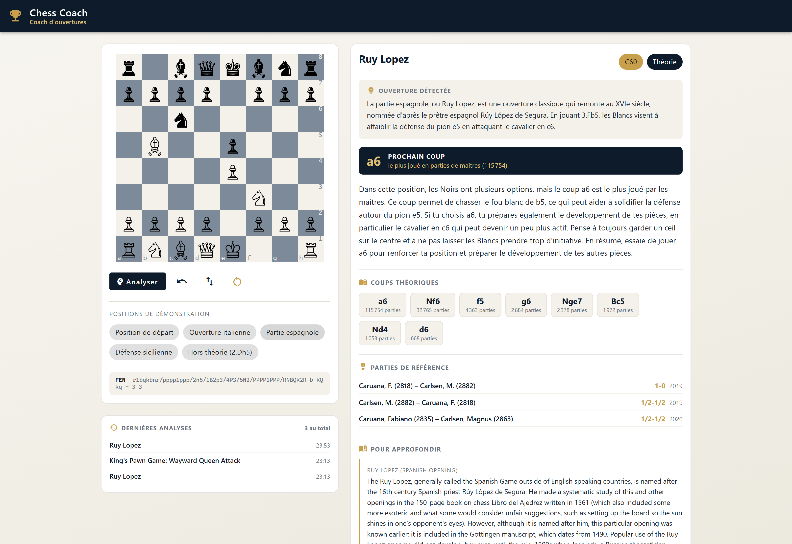
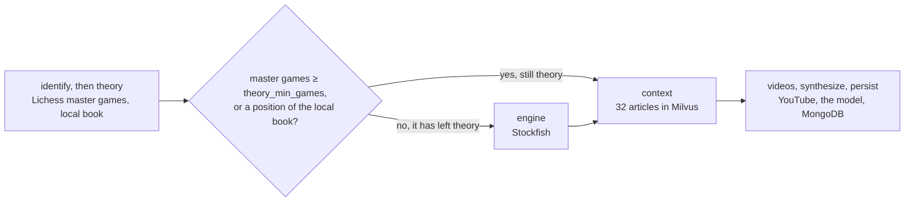
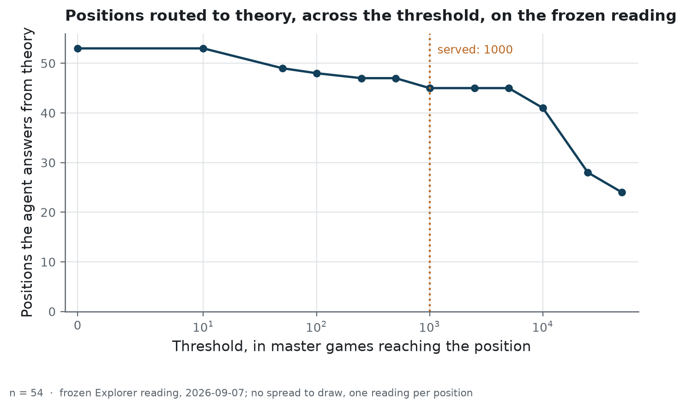
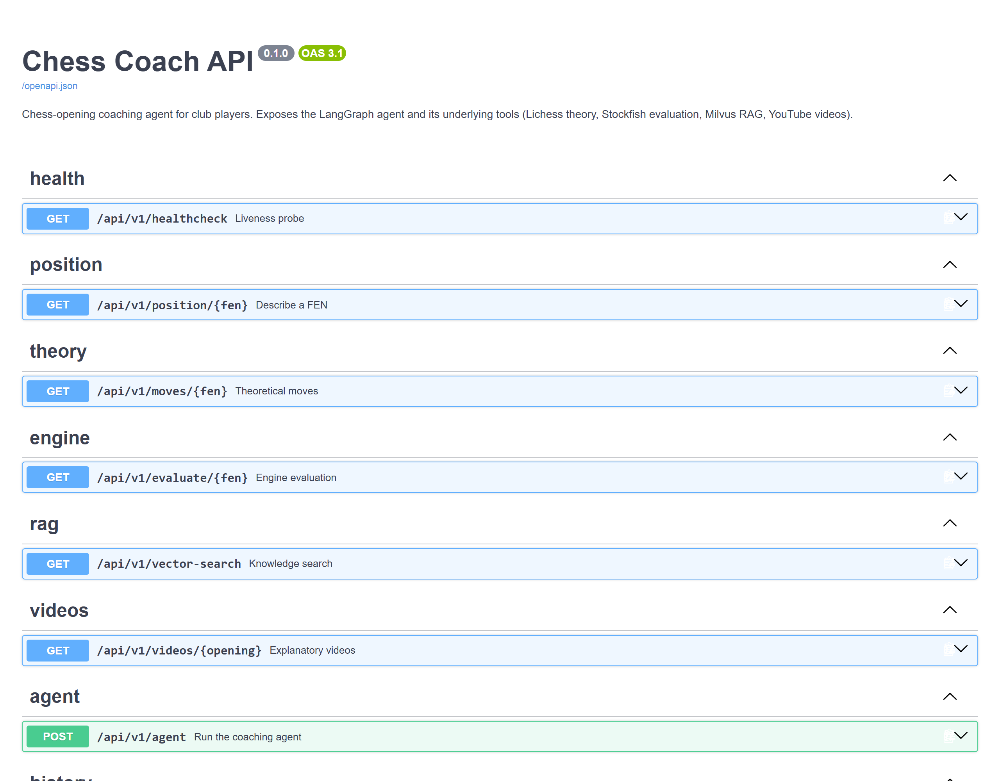

<h1 align="center">Chess opening coach</h1>

<p align="center">A LangGraph chess-opening coach that looks up its facts before a language model writes the answer</p>

<p align="center">
  
  
  
  
</p>

<!-- source: docs/images/MANIFEST.json -->


<div align="justify">

**Project status** — finished and archived. The coach is meant for club players learning their
openings. The stack starts with one `docker compose up`, which brings up six services, and the
vector store takes the longest to become ready. The measured numbers on this page come from
result files the repository tracks, each written by one script, with these exceptions. The
scores of the first published retrieval table come from the git history (commit `9199be9`).
Four counts were computed by hand from tracked files: the 37 positions the local book keeps in
theory, the empty range from 915 to 5 244 master games, the split of the moves present in the
prompt into 53 and 15, and the 22 prompts and 36 citations that carried the article header. The
CI workflow is started by hand and runs the linters and the tests. It does not recompute the
published tables. The last recorded run, on 2026-10-10, reproduced the routing sweep and the
move-invention tables (`backend/reports/run-evidence.json`). Readers download the reference
articles themselves, because FICGS reserves the rights to their text.

## The problem

A club coach asked about a position usually gives one of three answers. In a known opening, the
coach names it and explains the idea behind it. In a sideline that strong players avoid, the
coach says so and looks at what an engine recommends. When a video explains the line well, the
coach points the player to it.

The design of this repository starts from an assumption that it does not test: a language model
given the same position would mix the three answers and could invent the move counts it quotes.
Its writing would be good enough. It would have no signal telling it which of the three cases
applies, and no source for the counts.

In this repository the graph gathers the facts first, and the model writes from them. The theory
comes from a database of master games, the evaluation from an engine, the explanation from a
corpus of articles, and the videos from a search API. The model receives those facts and writes
a presentation of the opening in two or three sentences and a recommendation in four to six.

The system still has two decisions to make, and the repository measures both: when a position
counts as theory, and how to word the query sent to the knowledge base.

## What it does

The project runs as six containers under Docker Compose. A LangGraph agent collects facts about a
position from four sources and then writes the answer.



- **Theory**: the [Lichess Opening Explorer](https://lichess.org/api#tag/Opening-Explorer)
  over the master-games database. A local opening book of seventeen lines answers when no token
  is set or when the call fails, so the agent still answers without a token.
- **Engine**: [Stockfish](https://stockfishchess.org/), called only when the position is out of
  theory.
- **Context**: retrieval over 32 articles indexed in [Milvus](https://milvus.io/):
  21 [Wikichess](https://ficgs.com/wikichess.html) pages in English and 11 notes written in
  French for young players. The downloaded pages are kept out of this repository for a licence
  reason given in `docs/data-source.md`, and one command downloads them again.
- **Videos**: a search through the YouTube Data API.
- **Synthesis**: an OpenAI-compatible model writes the presentation and the recommendation, with
  an instruction to use only those facts. A deterministic French template writes them when no
  key is set, when `LLM_ENABLED` is false, or when the call fails, so the agent always answers.

Every analysis is written to MongoDB, and the interface lists the five most recent ones.

### How it is built

The backend is **FastAPI** served by **Uvicorn**. Every route declares a **Pydantic** response
model, and the OpenAPI page at `/docs` is generated from those models. The agent is a
**LangGraph** graph of seven nodes with two conditional edges. The first ends the run on an
invalid FEN. The second sends a position that is out of theory to the engine. The theory node
makes that call by comparing a count of master games with a threshold, or by finding the
position in the local book, and the routing study sweeps that threshold. **LangChain** appears
only in the synthesis node, as the client for OpenAI-compatible endpoints.

Retrieval uses **sentence-transformers** with a multilingual model, which **PyTorch** runs on
the CPU. The backend's dependency file points PyTorch at the CPU-only wheels. A comment in
`backend/pyproject.toml` puts the resulting image at about 2 GB and the CUDA wheels it avoids at
about 8 GB. Milvus stores the vectors and MongoDB the history. Stockfish is a binary installed in
the image and driven as a subprocess.

The interface is **Angular** with Angular Material and `ngx-chess-board`. It is served by nginx,
which forwards `/api/` to the backend. **uv** locks the Python dependencies. **pytest** runs
three tiers of tests and treats warnings as errors, **Ruff** checks linting and formatting, and
**Bandit** scans the source. The CI workflow runs all three when someone starts it.

## The result

### Query wording and retrieval

Retrieval is scored on 14 cases, one per opening. Each case gives the opening's name and ECO code
and lists the articles that count as a correct answer. Every variant builds its query from that
name, and the four variants were sent to the same corpus and the same index:

<!-- source: backend/reports/ablation_retrieval.json -->

| Variant | recall@1 | recall@3 | mrr |
|---|---|---|---|
| `name-only` (the opening name alone) | 0.93 | 1.00 | 0.964 |
| **`french-question`**, what the agent sends | **0.86** | **1.00** | **0.929** |
| `english-verbose` (a padded English wording) | 0.50 | 0.86 | 0.693 |
| `name-and-eco` (the name plus its ECO code) | 0.93 | 0.93 | 0.946 |
> n = 14 cases, each with a hard label and no judge.

> **How to read it.** Each row is one way of wording the query for the same fourteen openings,
> sent to the same corpus and index. `name-and-eco` appends the ECO (Encyclopaedia of Chess
> Openings) code to the name. recall@1 is the share of cases whose first result is a correct
> article, which is the passage a player sees first. recall@3 is the share in which a correct
> article is among the first three distinct articles retrieved; the agent itself receives three
> passages, which can come from fewer articles. MRR (mean reciprocal rank) averages
> 1/rank of the first correct article over the cases, so it separates two wordings that find the
> article at different depths. On fourteen cases one case moves recall by 0.07, and a difference
> of one case is a single case changing its result.

**The padded English wording loses five to six cases at the first rank.** Its recall@1 is 0.50,
against 0.86 for the French wording and 0.93 for the two other wordings: five or six of the
fourteen cases. In all seven cases it misses at rank 1, it returns the same article first,
`wikichess/00045`, titled "King's pawn game" (the page for 1.e4 e5 2.Nf3 Nc6 3.Bc4). For the
Ruy Lopez the first correct article comes at rank 6.

**The French wording scores one case below the bare opening name at the first rank.** On fourteen
cases that difference is 0.07 of recall, the smallest one this study can show. The three short
wordings are therefore not separated by the measurement. It does show that burying the opening
name among generic words costs five to six cases at rank 1. The Italian Game case does not count
`wikichess/00045`, the article on the position after 3.Bc4, among its correct answers, and all
four wordings return that article first for this case.

**Three of these four rows score lower at rank 1, and in MRR, than the first published version
of this table.** That version was measured on 2026-09-07. Since then the header block that opens
each article (its ECO code, its moves and, in a downloaded article, a FEN, a source URL and the
contributors) has been removed from the indexed text. The current table was measured on
2026-09-15 with the block already removed, and the change was committed on 2026-09-16
(`5d5e3be`). A screenshot of the interface had shown that block reaching the player as if it
were part of the passage, and it was also being embedded with the prose. The change cost the
served French wording one case at rank 1, from 0.93 to 0.86, and took `name-and-eco` from 1.00
to 0.93 at ranks 1 and 3. `name-only` is unchanged, and `english-verbose` lost a case at rank 1
and gained one at rank 3.

The earlier perfect score of `name-and-eco` came from a leak. Its query carried the ECO code,
and so did the header of the article it was looking for, so the score measured a shared string.
The case file states that no case was drawn from its target article, for the same reason. The
numbers in the table are measured on text without the header.

### Sensitivity of the routing threshold

`theory_min_games` is the number of master games from which the agent treats a position as
theory. It decides whether a player gets the theory half of the product or the engine half. Its
value was first chosen by looking at two positions by hand. The table applies it to a frozen
reading of 54 positions:

<!-- source: backend/reports/theory_threshold_sweep.csv -->

| threshold | in_theory | flipped |
|---|---|---|
| 100 | 48 | 1 |
| 500 | 47 | 0 |
| **1000** *(served)* | **45** | **2** |
| 2500 | 45 | 0 |
| 5000 | 45 | 0 |
| 10000 | 41 | 4 |
| 25000 | 28 | 13 |
> n = 54 positions, read from the `masters` database on 2026-09-07.

> **How to read it.** Each row is one candidate value of `theory_min_games`. `in_theory` counts
> the frozen positions that have at least one recorded move and at least that many master games,
> which the agent answers from the Explorer when it has a token. `flipped` counts the positions
> that change side against the previous value of the full sweep, published in
> `backend/reports/theory_threshold_sweep.md`. That sweep also tests 0, 10, 50, 250 and 50 000, so
> the 500 row is compared with 250. A zero means the routing did not change between the two values.

<!-- source: backend/reports/figures/MANIFEST.json -->


> **How to read it.** The horizontal axis carries all twelve values of the full sweep on a
> symmetric-log scale: linear from 0 to 10 so that 0 can be placed, logarithmic above. The
> vertical axis
> counts the positions answered from master games. A flat stretch means the routing does not
> depend on the exact value chosen inside it. The dotted line marks the value the service uses,
> at the left end of the flat stretch that runs from 1 000 to 5 000. The drop at the right is
> where a higher value starts removing main-line positions from the master-game answer.

Dividing the served value by three moves 2 of the 54 positions to the other side, and multiplying
it by three moves none. On this reading no position has between 915 and 5 244 master games, so
any value in that range gives the same routing. The value of 1 000 was chosen from two examples,
and the sweep shows that it falls inside that stable range.

The sweep applies the Explorer rule alone. In the agent, a position below the threshold is also
looked up in the local opening book, and it stays in theory when the book contains it. On these
54 positions the book changes nothing up to 10 000. At 25 000 it would keep 37 positions in
theory, nine more than the table shows. `docs/protocol.md` gives the details.

The reading is committed with the date it was taken. The Explorer's counts grow as games are
added, so a sweep that queried it again would produce different numbers.

### Latency of each node

Four positions were timed inside the deployed configuration, three times each:

<!-- source: backend/reports/latency.json -->

| Node | median_ms | p90_ms |
|---|---|---|
| `context` (embedding and Milvus search) | 18.0 | 20.0 |
| `theory` (the Lichess Explorer call) | 76.2 | 80.4 |
| `videos` (the YouTube Data API call) | 276.1 | 312.4 |
| `engine` (the Stockfish call) | 346.1 | 392.1 |
> n = 12 timings per node, 6 for the engine, which runs only on positions that left theory.
> The engine is called at the depth `STOCKFISH_DEPTH` sets, fifteen plies in this configuration.

> **How to read it.** One row per node of the agent's graph, timed inside the deployed
> configuration. `median_ms` is the typical wait in milliseconds: half the calls were faster.
> `p90_ms` is the ninetieth percentile, taken as the tenth fastest of twelve calls (the fifth of
> six for the engine), so it describes the slower calls. A wide gap between the two columns means
> that some calls take much longer than usual. With so few timings no interval is published.

<!-- source: backend/reports/figures/MANIFEST.json -->


> **How to read it.** Each row is one node. The scale is logarithmic because the values drawn
> run from 18 ms to more than 8 s. The dot is the median, the thick segment runs from the median
> to the ninetieth percentile, and the thin line continues to the slowest call recorded. A short
> thick segment followed by a long thin line marks a node that is usually fast and occasionally
> slow. The language model is left out of this bench. In a real request it is expected to take
> longer than any node drawn here; it was not timed.

The retrieval node, which embeds the query and searches Milvus, is the fastest: its median is
about a quarter of the Explorer call's. In a typical request most of the time goes to the engine
and to YouTube, with medians of 346 and 276 ms, and the engine runs only for positions out of
theory. Over the whole bench, the single slowest search, 8.3 s, outweighs all the engine and
YouTube calls together; the bench loads the embedding model inside its first search. The bench
leaves out the synthesis node, because the model call is billed and one slow generation on a
third-party endpoint would hide every local node. In a real request the model is expected to be
the largest cost; it was not timed.

### Moves cited by the language model

One line of the system prompt forbids citing a move that was not given. Twenty-one positions
were each put twice to `gpt-4o-mini`, 42 billed calls, covering both branches of the graph:
twelve positions in theory and nine out of it.

<!-- source: backend/reports/move_invention.json -->

| Where a cited move came from | citations |
|---|---|
| Present in the prompt (tool output or the list of legal moves) | 68 |
| The opening's own line, quoted behind its move number | 45 |
| Legal in the position, absent from the prompt | 1 |
| No such move in the position | 2 |
> n = 116 cited moves, over 21 positions answered twice.

> **How to read it.** Each row is one possible origin of a cited move, and `citations` counts the
> moves with that origin. The first row holds moves present in the prompt, either in the output of
> a tool or in the list of legal moves. The second holds moves of the opening's own sequence,
> written after a move number. The last two rows hold moves the model produced by itself, one
> legal in the position and two that cannot be played in it. The reader counts only those two rows
> as departures from the instruction.

**Three citations were neither in the prompt nor part of the opening's sequence.** Each of them
was read by hand:

- *Caro-Kann*: `e5`, a plan mentioned in passing, legal in the position. It is the only move the
  model proposed without the prompt containing it.
- *Italian*: `a6`, Black's reply in a line not yet played. It is illegal in the current position
  because White is to move.
- *Scholar's Attack*: `Qh5`, the move that produced the position on the board. It is correct,
  and illegal in the current position because it has already been played.

The model's own words for the three are quoted in
[`backend/reports/move_invention.md`](backend/reports/move_invention.md), in French, the
language it was asked to coach in.

The two moves flagged as impossible therefore come from judging every citation against the
current board, while a coach also talks about moves already played and moves to come. Of the 116
citations, 113 were either present in the prompt or part of the opening's own sequence. Of the
68 present in the prompt, 53 appear among the theoretical moves, the engine's move or the
retrieved passages, and 15 appear only in the list of the position's first twelve legal moves,
which the prompt also carries. The 45 moves of the opening's sequence are not checked. The run
dates from 2026-09-08, before the header block was removed from the indexed text (commit
`5d5e3be`, 2026-09-16). In 22 of the 42 prompts a retrieved passage still carried that header,
with the opening's first moves, and 36 of the 45 come from answers to those prompts. The
measurement therefore used a prompt that the service no longer produces.

## Why these numbers can be believed

**The retrieval study replaces a claim that had no record.** The docstring of
`build_context_query` stated that a short French query beats a padded English one, from a check
on the live index. The repository kept no record of which openings were tried or what came back,
so the claim could not be replayed. The ablation above confirms it and puts the gap at 36 points
of recall@1.

**The cases were written by hand from the corpus index, and each label is a file name.** The case
file records the rule: a case drawn from the text of its target article would measure string
matching. Because the label is a file name, the score needs no judge and no billed call.

**An opening can have more than one correct article.** Three files cover the Ruy Lopez, so that
case is labelled with all three. A label naming only one of them would mark a retrieval wrong
when it returned another correct file.

**Fragments of one article count once.** An article is indexed as several chunks, and one opening
could otherwise fill the whole top three. The ranking is reduced to distinct files before the
cut at k, which keeps the chunking from raising the score at every k.

**Warnings are errors.** The test configuration used to ignore three whole categories of warning
(DeprecationWarning, PendingDeprecationWarning and UserWarning), on a stack built from six
libraries that change quickly. After the switch to `filterwarnings = ["error"]`, the first run
surfaced one deprecation, from the Starlette test client. The fix installed `httpx2`, the client
that test client asks for, and added no filter.

**The citation reader handles three shapes that would otherwise look like invented moves.**
Second moves of narrated lines, squares named as places, and first moves quoted from an
opening's history each have a unit test in `backend/tests/unit/evaluation/test_eval_moves.py`,
and [`docs/protocol.md`](docs/protocol.md) describes them. `backend/reports/move_invention.md`
also gives the counts obtained when every square-looking token is read as a move.

**The tests replace the external services.** The unit and integration tiers replace Lichess,
YouTube, Milvus and MongoDB with fakes, and run without a language model. The three tiers differ
in what they may touch. `backend/tests/unit/` refuses any connection to a host other than the
local machine. `backend/tests/integration/` wires two real components together.
`backend/tests/system/` starts the API as a separate process, points Milvus at a closed local
port and empties the Lichess, YouTube and model keys. That process reads the embedding model
from the local Hugging Face cache only (`HF_HUB_OFFLINE=1`). With an empty cache the model cannot
be loaded, and the search route answers 503 as it does when Milvus is closed. The system tier
was added in the same change that applied the three-second Milvus timeout and added the
loading of the embedding model at start-up.

Three tests check the evaluation itself: that every label names an article of the corpus, that
the `french-question` variant returns what the agent's own function returns, and that raising
the threshold never adds positions to theory. Another test judges the 42 saved answers of the
move-invention check again and compares the totals with the published table.

## Running it

Docker Desktop must be running. [`docs/operations.md`](docs/operations.md) covers the rest: the
order in which the services start, which routes work before the others, and what to check when
the interface stops answering.

```powershell
copy .env.example .env       # optional keys: Lichess, YouTube, a language model
docker compose up -d --build

# download the Wikichess articles, which git does not track
docker compose run --rm backend python -m scripts.fetch_wikichess

# load the knowledge base into Milvus once; the volume keeps it
docker compose run --rm backend python -m scripts.ingest_wikichess
```

- Interface: <http://localhost:4200>
- API documentation: <http://localhost:8000/docs>

None of the three keys is required. Without them the local book answers in place of the
Explorer, the template writes in place of the model, and no video is proposed.

[`docs/protocol.md`](docs/protocol.md) gives the command that reproduces each measurement and
says what each design can and cannot separate. The checks are `uv run pytest`,
`uv run ruff check .` and `uv run bandit -c pyproject.toml -r src` from `backend/`, and
`npm test -- --watch=false --browsers=ChromeHeadless` from `frontend/`.

The API has eight routes, documented on the generated OpenAPI page:

<!-- source: docs/images/MANIFEST.json -->


## Structure

```
├── backend/                  README: the API and its measurement scripts
│   ├── data/
│   │   ├── openings/         11 notes written in French, indexed beside the Wikichess articles
│   │   └── eval/             the frozen inputs of the measurements
│   ├── notebooks/            the walkthrough, from a FEN to the agent's prompt
│   ├── reports/              the measurement results, the figures and the run evidence
│   ├── scripts/              download, ingestion, measurements, figures, the smoke run
│   ├── src/chess_coach/
│   │   ├── agent/            LangGraph state, nodes, graph, synthesis
│   │   ├── api/              routes, schemas, and the mapping between them
│   │   ├── evaluation/       the metrics, the query variants, the sweep, the citation reader
│   │   ├── rag/              chunking and indexing
│   │   ├── services/         Lichess, Stockfish, YouTube, Milvus, MongoDB, the opening book
│   │   ├── utils/paths.py    every path of the project, resolved in one place
│   │   └── config.py         every setting, read from the environment
│   ├── tests/                unit, integration and system
│   └── var/                  what a run leaves behind, including the downloaded corpus
├── frontend/                 README: the Angular interface
├── docs/                     architecture, data, protocol, operations, and one study
└── docker-compose.yml        the six services
```

[`docs/architecture.md`](docs/architecture.md) describes the six containers, the graph, how each
service behaves when it fails, and four designs that were considered and not built. The two
other READMEs are [`backend/README.md`](backend/README.md) and
[`frontend/README.md`](frontend/README.md).
[`docs/feasibility_video_analysis.md`](docs/feasibility_video_analysis.md) is a study of a
video-analysis module that has not been built, and [`metrics.yaml`](metrics.yaml) defines each
numeric column of the tables above.

## What this does not prove

**Fourteen cases is a small set.** One case is worth 0.07 of recall, so the ablation can only
separate wide gaps. It shows that padding the query costs five to six cases at rank 1, and it
does not rank the three wordings that scored within one case of each other.

**Thirty-two articles is a small corpus.** With so few articles a correct one is often within
reach, and a high recall@3 reflects the corpus as much as the retrieval. The effect of the
query's wording remains measurable.

**One model, forty-two answers.** The invention check ran on `gpt-4o-mini` at temperature 0.3,
twice over twenty-one positions. Another model, or a longer answer, could behave differently.
The check is a script, kept out of the test suite because each fresh run is billed.

**The second half of the instruction is unchecked.** The model is also told to mention the engine
only when an evaluation was supplied. Nothing counts how often it follows that rule, and counting
it would need a reader built for that question.

**The opening sequences the model quotes are not verified.** Forty-five citations are moves of an
opening's own sequence, written after a move number. Whether the sequence is the right one is
not checked, because the frozen reading stores positions and the move orders that reach them are
not recorded.

**The corpus is used as published.** The Wikichess articles are indexed without their header
block, and each downloaded file keeps its source URL and the names of its contributors. The
repository measures which article is returned. Whether the article's content is correct is
outside its scope.

**The quality of the written answer is not measured.** Measuring it would take a judge, and a
judge's score depends on the judge as much as on the answer.

**Nothing here has been deployed.** The stack is six containers on one machine, reached on
localhost ports. `docs/operations.md` lists what a deployment would need and what the stack
already provides.

## Licence and data

Code under [MIT](LICENSE). [`docs/data-source.md`](docs/data-source.md) describes where each
source comes from and what its terms allow.

Twenty-one of the thirty-two articles come from [Wikichess](https://ficgs.com/wikichess.html),
whose terms reserve the text of the site and allow copying games only. `docs/data-source.md`
quotes the clause. The article files are therefore not tracked by git. The repository tracks
[`backend/reports/wikichess_manifest.json`](backend/reports/wikichess_manifest.json), which names
each article and the page it was read from, and `backend/scripts/fetch_wikichess.py`, which
downloads the articles into a directory git ignores. The eleven French notes were written for
this repository.

Beyond the titles, ECO codes, opening moves and addresses listed in that manifest, the repository
publishes no text from the Wikichess articles. The 42 prompts saved by the move-invention check
keep, in place of each Wikichess passage, the identifier of its chunk and the moves the citation
reader found in it, and judging the answers again counts those moves as given. Earlier versions
of that file, of the walkthrough notebook and of a screenshot since removed show Wikichess
passages or article headers. Those versions remain in the git history.

The Lichess Opening Explorer and the YouTube Data API are called at run time under their own
terms, Stockfish is installed in the backend image, and no key is shipped. The frozen Explorer
reading, in `backend/data/eval/theory_positions.json`, records how many master games reached each
position on 2026-09-07.

</div>
