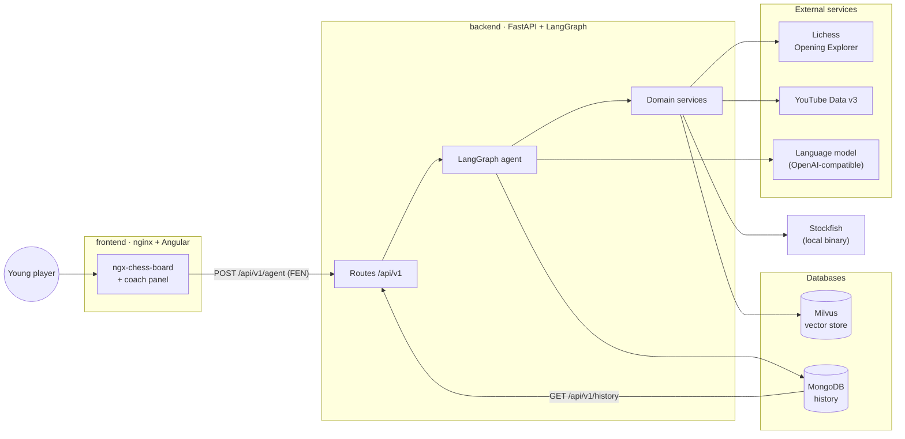
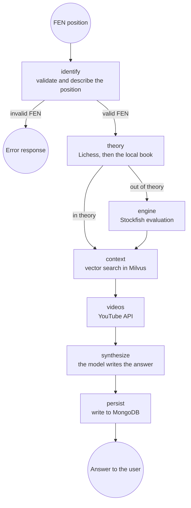
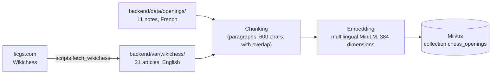

# Architecture

> This page describes what runs today. The video-analysis module, which has not been built, is
> described separately in `feasibility_video_analysis.md`.

---

## 1. Overview

The stack runs as six containers, started with one `docker compose up`.



Milvus depends on two infrastructure services, `etcd` for metadata and `minio` for object
storage. Both are declared in `docker-compose.yml`.

---

## 2. The agent's graph

The agent is a LangGraph graph. Each node reads the state, performs one task, and returns the
fields it adds.



The graph has two conditional edges. The first, after `identify`, ends the run when the FEN is
invalid. The second, after `theory`, chooses where the answer comes from: a position in theory
is answered from the theory, and a position out of theory goes to the engine.

The rule has to be explicit. Lichess's master database answers for almost any legal position,
so the agent judges a position by the number of games behind that answer. A position counts as
theory when the Explorer reports at least one move and at least `THEORY_MIN_GAMES` master games,
or when the local opening book contains it. The book also answers alone when no Lichess token is
set or when the Explorer call fails. The threshold defaults to 1 000. For scale, the Italian Game
after 3.Bc4 Bc5 has 25 559 master games and 1.e4 e5 2.Qh5 has 48, read on 2026-09-07.

The value of 1 000 was first chosen from those two examples. A sweep has since measured its
effect: at a third of the value, 2 of the 54 frozen positions change side, and at three times
the value none do. The README shows the rows around the served value,
`protocol.md` describes how the sweep was built, and
`../backend/reports/theory_threshold_sweep.md` holds the full curve.

The move the interface puts forward follows the same split. In theory it is the first
theoretical move, which is the move most played in master games when the Explorer answered.
Out of theory it is Stockfish's best move. The prompt tells the language model which move the
interface shows, so that the model comments on the move the player has in front of them.

When a position falls below the threshold and the local book does not contain it, the agent
keeps the Explorer's answer anyway. That answer often carries a name and a game count.
For 1.e4 e5 2.Qh5 the Explorer gives the name *"King's Pawn Game: Wayward Queen Attack"* and 48
master games, which tells a player that the line exists and that masters rarely play it. That is
more useful to them than *"unknown position"*.

The state collects the list of tools that contributed to the answer (`sources_used`), and the
interface shows that list under the answer.

---

## 3. The backend's layers

```
backend/src/chess_coach/
├── api/          # transport: thin routes, validation, HTTP codes
├── agent/        # orchestration: state, nodes, graph, synthesis
├── rag/          # chunking and indexing of the corpus
├── evaluation/   # metrics, query variants, threshold sweep, citation reader
├── services/     # domain services, most of them wrapping one external system
└── config.py     # settings, read from the environment
```

The dependencies run one way: `api` and `agent` call `services`, and `services` imports
neither. The agent can therefore be tested against fake services, with no network and no
container. `evaluation` imports the agent, and only the measurement scripts and their unit
tests import `evaluation`.

| Service | Role | Behaviour when it fails |
| --- | --- | --- |
| `lichess` | Theoretical moves and reference games | Raises an error, and the local book answers |
| `opening_book` | Local offline opening book of seventeen lines | Always available |
| `theory` | Chooses between the Explorer and the book | not applicable |
| `stockfish_engine` | Evaluation and best move | 502 on its own route; no evaluation in the agent |
| `embeddings` | Text vectorisation | Model loaded once per process and shared; when it cannot be loaded, 503 on the search route and no passages in the agent |
| `milvus_store` | Vector collection | 503 on its own route |
| `rag_search` | Embeds the query, then queries Milvus | No passages in the agent when Milvus or the embedding model fails |
| `youtube` | Video search | 503 without a key and 502 on failure on its own route; an empty list in the agent |
| `mongo` | History | Write logged and skipped, read empty |

Because of this behaviour the whole stack works without any key. The deterministic template
replaces the model, the local book replaces the Explorer, and the video section stays empty.

---

## 4. The knowledge base



The corpus has 32 articles in two folders. The Wikichess pages are not tracked by git, because
the FICGS terms protect the text of the site, so a download fills their folder before the first
ingestion. For those pages the repository tracks the manifest that lists
the articles of the corpus. Each indexed passage carries its source path, which starts with the
name of its folder. The ablation scores against that path, and the interface shows the title of
the article each passage comes from.

The corpus is bilingual: the Wikichess pages are in English, the complementary notes in French,
and the agent's queries are in French. The embedding model is multilingual for that reason. On
this corpus the padded English wording of the query loses 36 points of recall@1 against the
served French one, as the ablation table in the README and
`../backend/reports/ablation_retrieval.md` show.

---

## 5. The path of one request

1. The player makes a move, and the component reads the new FEN from `ngx-chess-board`.
2. The Angular component calls `POST /api/v1/agent` on a relative path.
3. nginx forwards the request to the backend over the internal Docker network.
4. The graph runs: validation, theory, the engine when the position is out of theory, context,
   videos.
5. The language model writes the recommendation from those facts, under an instruction to use
   nothing else. The deterministic template writes it when no model is configured or the call
   fails.
6. The interaction is written to MongoDB.
7. The interface renders, in this order: the detected opening with its ECO code, two or three
   sentences presenting it, the next move put forward, the recommendation, the theoretical
   moves, the reference games, the engine evaluation, the retrieved passages, the videos, and
   the tools the agent used.

Measured inside the deployed configuration, the median times are 18 ms for the vector search,
76 ms for the Explorer, 276 ms for YouTube and 346 ms for Stockfish. The language model was left
out of the bench because each call is billed. It is expected to take most of the time of a real
request; it was not timed.

---

## 6. Configuration and persistence

The service's settings (hosts, ports, keys, model names, timeouts and the routing threshold) are
read from environment variables in `config.py`, and `.env.example` documents each of them. A few
parameters are constants in the code: three passages retrieved per question, four videos, a
budget of 600 characters per chunk, and a model temperature of 0.3.

Five named volumes keep the state between restarts:

| Volume | Contents |
| --- | --- |
| `milvus_data` | The indexed vector store |
| `etcd_data` | Milvus metadata |
| `minio_data` | Milvus object storage |
| `mongo_data` | The interaction history |
| `hf_cache` | The downloaded embedding model |

With these volumes the demonstration restarts without a new ingestion of the corpus and keeps
its history.

---

## 7. Alternatives considered and not built

Four other designs were considered and not built.

**A language model answering the question directly.** The simplest design hands the position to
a model and lets it write. No version of it appears in the git history. The README states the
assumption behind setting it aside: such a model could not tell which of three situations it is
in, and would have no source for the counts it quotes. Here the model runs after the routing, which the master-game
count and the local book decide, and `docs/protocol.md` measures what the model then cites.

**A fine-tuned model in place of retrieval.** Thirty-two articles are too few to train on. The
corpus also changes when an article is added. A retrieval index takes the new article in one
ingestion, while a fine-tuned model needs another training run. The two also fail differently.
A retrieval that misses returns the wrong article under that article's title, which the player
can see. A fine-tuned model that misses produces invented text with no visible source.

**An agent that chooses its own tools.** LangGraph supports a model deciding which tool to call.
The graph here is fixed, and its routing edge depends on a game count compared with a threshold
and on a lookup in the local book. The threshold can be swept: `docs/protocol.md` applies it to
fifty-four positions and counts how many change side. A routing chosen by a model inside its
prompt has no such parameter to sweep.

**Video analysis.** The question was whether the coach could point to the moment in a video
where the current position is explained. The study is
[`feasibility_video_analysis.md`](feasibility_video_analysis.md). It describes a pipeline that
samples video frames, reads the board in each frame, converts it to FEN and indexes each position
with its timestamp. It estimates the build at 85 person-days, about €40 000 in all, and the
running cost at about €68 a month. It recommends a five-week framing and proof-of-concept phase
before any larger commitment. None of it is built in this repository.
