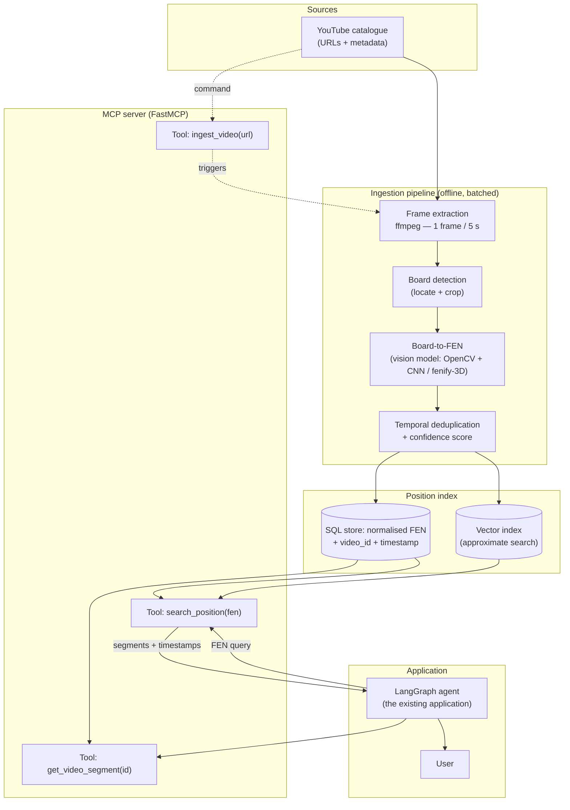

# Feasibility note: video analysis for position search

> Video analysis for a chess agent
> Preparatory technical note: design of an advanced position-indexed video module
> Version 1.0, June 2026; figures revised in October 2026

---

## 1. Context and objective

The chess agent helps players with the position of a game in progress: it suggests moves,
explains plans, and points them to learning material. Video is central to that material.
YouTube holds a large amount of teaching content, including grandmaster analyses, opening
courses, theoretical endgames and annotated games. The agent already recommends videos, through
a plain text query sent to the YouTube search API.

That approach has a limit. When a user faces a specific position, for example a Sicilian Najdorf
structure after the fifteenth move, the agent can only return a *thematic* video such as
"Understanding the Najdorf", forty-five minutes long, and the user has to scrub through it to
find the relevant passage. The user needs the explanation of that position, at the second where
it is given. This note addresses the gap between the granularity of the search (a video title)
and the granularity of the need (a moment inside a video).

**What the proposed system does.** It analyses a catalogue of teaching videos, extracts the
chess positions displayed on screen, converts them to FEN (*Forsyth–Edwards Notation*), and
indexes them so that every position is bound to a `(video, timestamp)` pair. The existing agent
could then query the module with the exact position of the game in progress and receive a video
link that starts at the second where that position is explained.

This document is a design feasibility note. It describes the system, its target architecture
around an MCP (Model Context Protocol) server, its benefits and limits, its forecast costs
(CAPEX and OPEX) and risks, the alternatives, and a roadmap. No software is delivered with it,
and no development is committed at this stage.

**Scope.** The system targets videos that show a **synthetic 2D board**, the diagrams that an
analysis tool such as Lichess, Chess.com or ChessBase generates. This note assumes that such
diagrams make up the large majority of teaching content. Physical boards filmed in perspective
and stylised 3D pieces are treated as degraded cases (see §5).

---

## 2. Functional description

The system provides two services that run in two very different regimes: ingestion (offline,
in batches) and query (online, in real time).

### 2.1 Catalogue ingestion (offline)

1. **Catalogue management.** A list of YouTube URLs is maintained, with video ids and metadata:
   title, author, language, topic, licence. The list can be extended by hand or by automatic
   discovery over a vetted set of channels.
2. **Fetching the stream.** For each video, the stream is fetched at a resolution sufficient to
   read the board. This note assumes that 720p is enough for a 2D diagram.
3. **Frame sampling.** ffmpeg extracts one image at a fixed interval, with a reference rate of
   **one frame every 5 seconds**. A chess position usually stays on screen for several seconds,
   and processing every frame would cost far more for no gain.
4. **Board detection.** On each frame, a detector locates the region that holds a board,
   cropping it and correcting the perspective where needed. Frames with no board, such as the
   commentator's face, a title card or an advert, are discarded.
5. **Board-to-FEN conversion.** A vision model recognises the piece on each square and produces
   a FEN string that describes the position. Candidates include *fenify-3D*, or an OpenCV
   grid-detection pipeline followed by a CNN that classifies the 64 squares.
6. **Temporal deduplication.** This step shapes what the index contains. A teacher who comments
   on one position for eight minutes leaves the same diagram on screen. At one frame every five
   seconds, that single position would produce **96 identical records**, and the user would be
   offered the same video 96 times. Consecutive frames that describe the same position are
   therefore merged into one record. The record keeps the timestamp of the first appearance,
   when the teacher starts talking about the position, and that is where the user should be
   sent. A position that reappears later in the video, after several others, becomes a new
   record, because the teacher has come back to it for a different reason.

   The user never receives a frame. Frames are intermediate files of the processing and are
   deleted after extraction. The user receives the (video, timestamp) pair as a timestamped
   link.
7. **Indexing.** Each position is stored as
   `(FEN, video_id, start_timestamp, end_timestamp, confidence, metadata)` in a queryable store.

### 2.2 Position query (online)

From the existing agent:

1. The agent already holds the current position as a FEN in its state.
2. It calls the module's search tool with that FEN.
3. The module queries the index and returns the video segments that match the position, or a
   very close one, sorted by relevance and source quality.
4. The agent gives the user a deep link of the form `https://youtu.be/<id>?t=<seconds>`, with
   the title and the author.

The granularity moves from a whole video to a second inside a video, which addresses the
problem stated in §1.

### 2.3 Normalisation and tolerance

A full FEN carries the side to move, the castling rights, the en-passant square and the move
counters. For a teaching search only the piece placement (the first FEN field) and, ideally,
the side to move matter, so the index uses a normalised key made of the placement and the side
to move. Exact position search is the main function. Approximate search, over positions one or
two moves away or over identical pawn structures, is planned as an extension to absorb small
recognition errors and to widen recall.

---

## 3. Technical architecture (MCP server)

The architecture separates the ingestion chain (in batches, heavy on compute) from the query
chain (light, in real time). The two meet on a shared position index. The agent reaches the
module through an MCP server implemented with FastMCP, which exposes standard tools and hides
the internals.

### 3.1 Architecture diagram

### 3.2 The same flow in words

`YouTube catalogue` → `ffmpeg (1 frame / 5 s)` → `board detection (crop / perspective)` →
`board-to-FEN (vision model)` → `deduplication + confidence` → `index (SQL FEN+timestamp
and vector index)`. Alongside the pipeline, the MCP server reads that index and exposes three
tools. The LangGraph agent calls `search_position(fen)` with the current position, receives a
list of `(video, timestamp)` segments, and gives the user a timestamped link. The ingestion
command `ingest_video(url)` sends a new video to the start of the pipeline.

### 3.3 Components

- **Catalogue manager**: a table of videos (id, URL, title, author, language, topic, licence,
  ingestion status, date of last processing). It also serves as the work queue.
- **Frame extractor (ffmpeg)**: run with a rate filter (`-vf fps=1/5`), it keeps one decoded
  frame every five seconds and writes only those images. The step runs on the CPU.
- **Board detector**: finds the 8×8 grid and corrects its orientation and framing. For a 2D
  diagram, contour and line detection (Hough transform, OpenCV) is enough. For a filmed board, a
  homography is estimated.
- **Board-to-FEN model**: the central component. It cuts the board into 64 squares, classifies
  each square into one of 13 states (6 pieces × 2 colours, plus empty), and emits the FEN with an
  aggregate confidence score.
- **Deduplication module**: compares successive FENs, merges repeats, and keeps the first
  timestamp and the highest confidence.
- **Position index**: a SQL store (a `positions` table) for exact lookup on the indexed
  normalised FEN, and an optional vector index that encodes the position (a 64-square vector or
  a structure embedding) for approximate search.
- **MCP server (FastMCP)**: the exposure layer. It holds little domain logic and translates tool
  calls into index queries or ingestion commands.

### 3.4 Exposed MCP tools

| Tool | Input | Output | Use |
|---|---|---|---|
| `search_position` | `fen` (placement + side to move), optional `tolerance` | list of `{video_id, title, author, timestamp, timestamped_url, score}` | Called by the agent with the current position |
| `get_video_segment` | `video_id`, `timestamp` | segment metadata, deep link, context (neighbouring positions) | Building what the user sees |
| `ingest_video` | `url` or `video_id` | ingestion status (queued/running/done), positions extracted | Catalogue administration |

### 3.5 Data flow: ingestion and query

- **Ingestion**: asynchronous and in batches, triggered when a video is added or on a schedule.
  It uses the GPU (board-to-FEN) and the CPU (ffmpeg) and writes to the index. Its latency is not
  critical: several minutes per video are acceptable.
- **Query**: synchronous, triggered by the agent. It needs almost no compute, one indexed read.
  Its latency is critical, with a **target below 200 ms** so that the lookup goes unnoticed in
  the conversation.

This separation keeps the GPU cost out of the user's response time, because all the heavy work
happens once, upstream.

---

## 4. Expected benefits

- **Precise relevance.** The user gets the exact *second* where the position is explained, in
  place of a whole video to scrub through. This is the main gain.
- **Reuse of the agent's state.** The agent already holds the FEN of the game in progress, so the
  user has nothing extra to provide.
- **Decoupling through MCP.** Exposing the module over MCP isolates it from the agent's
  internals. The same server could serve other clients, such as a web interface or another
  assistant, without a rewrite.
- **Value drawn from existing material.** Thousands of hours of good teaching on YouTube have no
  fine-grained index. The system would add a position-level access layer, which the text search
  of YouTube does not provide.
- **Incremental accumulation.** Every ingested video stays in the index, so the value grows with
  the catalogue at a low marginal ingestion cost (see §6).
- **Approximate search later.** Beyond the exact position, the vector index would support
  requests such as "show me videos about similar pawn structures", a useful teaching feature.
- **Measurability.** Coverage (the share of current positions found in the index) and
  board-to-FEN accuracy can be tracked, so the value delivered can be expressed as a number.

---

## 5. Technical and business limits

- **Board-to-FEN accuracy.** This is the main risk. A single misclassified square produces a
  wrong FEN, and therefore a missing or wrong index key. This note assumes a per-square accuracy
  of 99 % on clean 2D diagrams; the figure is an assumption, and no board-to-FEN model was
  measured here. At 99 % per square, a position with 32 occupied squares has about a
  0.99³² ≈ **72 %** chance of being read *entirely* correctly if only the occupied squares can be
  misread. If any of the 64 squares can be misread, empty ones included, the chance falls to
  0.99⁶⁴ ≈ **53 %**. The gate of phase 1 (§9), at least 70 % of positions read correctly,
  therefore needs a per-square accuracy of about 98.9 % in the first case and about 99.4 % in
  the second. A confidence score and a rejection threshold are required to keep the index clean.
- **Visual diversity.** Board colour themes, piece sets, overlays (arrows, highlighted squares,
  channel branding), banners and logos all disturb the classifier. Each style may need
  adaptation or partial retraining.
- **Camera angles and 3D pieces.** Videos of physical boards filmed in perspective, and stylised
  3D renders, make recognition much less reliable. They are outside the priority scope and would
  be handled later, or dropped.
- **Storage volume.** Storage stays small as long as raw frames are not kept. The arithmetic of
  §6.2 puts the durable storage at about 2 GB with one thumbnail per position, and at a few tens
  of megabytes for the index alone. The temporary frames, 21.6 GB for the initial catalogue, are
  the largest item, and they can be deleted after processing.
- **GPU cost.** Board-to-FEN inference over the whole catalogue is the most expensive step. It
  stays modest in absolute terms (see §6), because it runs once per video and parallelises well.
- **Copyright and YouTube's terms.** This is a sensitive business point: downloading and storing
  frames from third-party videos touches copyright and YouTube's terms of use. The recommended
  strategy is to redistribute none of the content; to keep only the FEN and the timestamp
  durably, as data this note assumes to be *factual* and not protected by copyright, pending the
  legal review below; to delete the frames after extraction;
  and to return only a deep link to the original video, so that the creator keeps the views and
  the revenue. A legal review is needed before industrialisation.
- **Catalogue maintenance.** Videos get deleted, made private, or re-uploaded with new URLs, and
  their timestamps stop being valid. Periodic link validation and a re-ingestion policy are
  required.
- **Ingestion latency and freshness.** A newly published video becomes searchable only after it
  has gone through the pipeline. That delay is acceptable for teaching use, and it must be
  documented.
- **Incomplete coverage.** Many positions appear in no video, so the system complements the
  existing search and cannot guarantee an answer to every query. The classic text search has to
  remain available as a fallback.

---

## 6. Feasibility and cost estimate

### 6.1 Sizing assumptions

Every value in this table is an assumption chosen for the estimate. None of them was measured in
this repository.

| Parameter | Value used | Why |
|---|---|---|
| Initial catalogue size | **1 000 videos** | Assumed to cover the main French- and English-language teaching channels |
| Average video length | **12 min** = 720 s | Assumed typical length of a course or an analysis |
| Sampling rate | **1 frame / 5 s** | A position stays on screen for several seconds |
| Working resolution | 720p, JPEG ~**150 KB**/frame | Assumed enough to read a 2D diagram |
| Share of frames holding a board | **~40 %** | The rest: commentator, titles, transitions |
| Unique positions after deduplication | **~12 / video** | A video works through a limited number of key positions |
| Board-to-FEN inference (detection + 64 squares) | **~0.2 s/frame** on a T4 GPU | Detection + CNN pipeline |
| Object storage | **€0.02/GB/month** | Assumed standard S3/Blob price, 2026 |
| T4 GPU | **€0.40/h** | Assumed on-demand cloud price, 2026 |
| Loaded day rate | **€450/day** | Junior engineer, employer cost |

### 6.2 Order-of-magnitude arithmetic

**Frames extracted**: 720 s ÷ 5 s = **144 frames/video**, so 144 × 1 000 = **144 000 frames**
for the catalogue.

**Frames holding a board**: 144 000 × 40 % ≈ **57 600 frames** worth running board-to-FEN on.
The other frames are dropped early, but the compute budget below covers all 144 000 frames, as
a margin of safety.

**Indexed positions**: 12 × 1 000 = **~12 000** unique positions. Positions are what a user
searches for, so they are the unit the cost is expressed in.

**Storage.** Keeping *every* frame would take 144 000 × 150 KB ≈ **21.6 GB**. In practice the
frames are deleted once the FEN is extracted. If one thumbnail is kept per indexed position, the
thumbnails take 12 000 × 150 KB ≈ **1.8 GB**. The SQL index (FEN and metadata) takes a few tens
of megabytes. **Durable storage budget: ~2 GB.** The thumbnails are optional: the copyright
strategy of §5 keeps only the FEN and the timestamp, and without thumbnails the durable storage
falls to the few tens of megabytes of the index. The budget keeps them as an upper bound.

**Ingestion GPU (initial catalogue)**: 144 000 frames × 0.2 s = 28 800 s ≈ **8 GPU hours**. With
a margin for retries, frames cropped twice and overhead: **~12 GPU hours**. At €0.40/h that is
**~€5** to process all 1 000 videos. The GPU cost is therefore small. The download and the ffmpeg
extraction run on the CPU, and this note assumes that they cost a few euros as well; for the
monthly ingestion, §6.4 budgets the CPU (download and extraction) at €5, above the €2 of GPU.

### 6.3 Setup costs (CAPEX)

| Item | Description | Days | Cost (€) |
|---|---|---:|---:|
| Vision model R&D | Selecting and evaluating board-to-FEN, fine-tuning on diagram styles, annotated test set, confidence thresholds | 25 | 11 250 |
| Ingestion pipeline | Catalogue, ffmpeg extraction, batch orchestration, deduplication | 15 | 6 750 |
| Position index | SQL schema, FEN normalisation, vector index, queries | 10 | 4 500 |
| MCP server (FastMCP) | `search_position`, `get_video_segment`, `ingest_video`, tests | 12 | 5 400 |
| LangGraph integration | Wiring the tool into the agent, rendering timestamped links | 8 | 3 600 |
| Evaluation and quality | Precision/recall metrics, validation set, test bench | 10 | 4 500 |
| Documentation and deployment | Technical doc, CI/CD, first production rollout | 5 | 2 250 |
| **Labour subtotal** | | **85 d** | **38 250** |
| Initial infrastructure and R&D | Development GPU (~150 h), storage, environments | — | 2 000 |
| **CAPEX TOTAL** | | | **≈ €40 250** |

Each labour line is its number of days at the €450 day rate of §6.1. The day counts are
assumptions, and so is the €2 000 line: the development GPU (~150 h at €0.40/h, about €60)
accounts for a small part of it, and the storage and environments that make up the rest are an
estimate.

### 6.4 Monthly running costs (OPEX)

Growth assumption: **+200 new videos a month** ingested, plus a partial re-ingestion as a check.

| Item | Basis | Monthly (€) |
|---|---|---:|
| Object storage (index + thumbnails) | ~2 GB × €0.02/GB ≈ €0.04, growing ~0.4 GB/month; budgeted at ~€1 as a wide margin | ~1 |
| Ingestion GPU | 200 videos × 144 frames × 0.2 s ≈ 1.6 h, plus margin and re-ingestion ≈ 5 h × €0.40 | ~2 |
| CPU (ffmpeg) | Download and extraction, on-demand instance | ~5 |
| Managed database | Small managed SQL instance | ~25 |
| MCP server hosting | Small always-on VM (1 vCPU / 1–2 GB) | ~30 |
| YouTube API quota | Data API v3; the free quota is assumed sufficient at this volume | 0 |
| Monitoring and logs | Basic supervision | ~5 |
| **OPEX TOTAL** | | **≈ €68/month** |

The monthly growth of storage comes from 200 videos × 12 positions × 150 KB ≈ 0.36 GB of
thumbnails. Every price in this table is an assumption, as are the margins added to the computed
GPU time (from 8 to 12 hours in §6.2, from 1.6 to 5 hours here).

### 6.5 Cost per indexed position

The initial catalogue holds **12 000 positions**. The figures below assume that the system runs,
and ingests 200 new videos a month, for the whole first year.

- **First year** (CAPEX plus 12 months of OPEX, €40 250 + 12 × €68 = €41 066):
  - over the 12 000 positions of the initial catalogue, ≈ **€3.42/position**;
  - over the 40 800 positions indexed by the end of the year (the initial 12 000, plus
    200 videos × 12 positions × 12 months = 28 800), ≈ **€1.01/position**.
- **Steady state** (OPEX only, development excluded): ~€816/year ÷ ~40 800 positions ≈
  **€0.02/position/year**, on a catalogue that keeps growing.

**How to read these figures.** Most of the cost is CAPEX, whose largest item is the vision
model's R&D (€11 250 of €40 250). Running the system is cheap: the GPU costs a few euros a month
because only one frame in every five seconds of video is processed. Hosting the MCP server and
the database accounts for €55 of the €68 a month, compute (GPU and CPU) for €7, and storage and
monitoring for the remaining €6. For 12 000 searchable positions the marginal cost is small. The
note estimates costs only, and puts no figure on the value the indexed positions would bring. The
factor that could stop the project is technical: board-to-FEN accuracy (§5).

---

## 7. Risks

| Risk | Likelihood | Impact | Mitigation |
|---|---|---|---|
| Board-to-FEN not accurate enough (wrong FENs) | High | High | Confidence threshold and rejection of doubtful frames; approximate search to absorb errors; annotated test set and tracked accuracy |
| Uncovered visual styles (overlays, themes) | High | Medium | Multi-style fine-tuning; visual normalisation; restrict the catalogue first to channels with a standard look |
| 3D boards / filmed in perspective | Medium | Medium | Out of priority scope; filtered upstream; those videos flagged as not indexable |
| Copyright / YouTube terms dispute | Medium | High | Store only FEN + timestamp (factual data), delete frames, return deep links only; legal review |
| Broken links / deleted videos | High | Low | Periodic validity check; "unavailable" status; scheduled re-ingestion |
| Coverage too thin (positions absent from the catalogue) | Medium | Medium | Fall back on text search; prioritise ingestion by most-requested topics; measure coverage |
| Query latency too high | Low | Medium | Exact index on the primary key; cache; strict ingestion/query separation |
| Dependence on an external board-to-FEN library | Medium | Medium | Abstract the model behind an interface; keep it replaceable; independent test set |
| Cost drift as the catalogue grows | Low | Low | Costs dominated by fixed hosting; GPU cost stays linear and small |

---

## 8. Alternatives considered

### 8.1 Alternative A: YouTube chapters and transcripts, with no vision

This note assumes that the chapters and the timestamped transcripts (subtitles) that YouTube
shows for many videos can be retrieved for indexing. A purely
textual approach would index those transcripts and search them by keyword, such as "Najdorf",
"the b5 push", or move names spoken aloud in algebraic notation.

- **Cost**: very low, with no GPU, no vision model and no heavy R&D. The labour is 5.7 to 8.5
  times smaller (an assumed ~10 to 15 days, against 85).
- **Value**: limited and imprecise. A teacher talks about plans and moves without reading out the
  full position or listing 32 pieces, so a transcript can locate a theme and cannot locate an
  exact position. It barely improves on the problem stated in §1.
- **Verdict**: useful as a cost baseline and as a fallback. It does not solve position-level
  pointing.

### 8.2 Alternative B: transcripts plus targeted vision

This approach first uses transcripts and chapters to pre-filter the videos and the relevant
passages, then runs the expensive board-to-FEN step only on those segments and leaves the rest
of the catalogue untouched.

- **Cost**: intermediate. Pre-filtering sharply reduces the number of frames analysed, down to
  the segments where a board is probably being discussed, and with them the GPU time and the
  annotation effort. This note does not cost this option; its CAPEX is expected to fall between
  the two others.
- **Value**: high. It keeps the position-level precision of vision where it matters, and uses
  the free textual signal for coverage and for the topic (a chapter title names one).
- **Verdict**: expected to give the best value for money, although it is not costed here, and
  the recommended end state. The plan starts with
  vision alone on a restricted catalogue to validate accuracy, then moves to the hybrid to scale
  at lower cost.

| Criterion | Proposed solution (vision) | A, transcripts only | B, hybrid |
|---|---|---|---|
| Exact position search | Yes | No | Yes |
| CAPEX | High | Low | Medium |
| OPEX | Low | Very low | Low |
| Catalogue coverage | Medium | High | High |
| Technical complexity | High | Low | Medium-high |

The ratings in this table are qualitative. Only the vision option is costed (§6), and
alternative A only for its labour.

---

## 9. Development roadmap

| Phase | Objective | Duration | Milestones | Gate |
|---|---|---|---|---|
| **0. Framing** | Scope, YouTube legal review, pilot channel selection | 2 weeks | 20–30 pilot videos listed, legal agreement in principle | Scope and compliance validated |
| **1. POC** | Prove board-to-FEN feasibility on 2D diagrams | 3 weeks | ffmpeg → board-to-FEN pipeline over 20 videos; per-square and per-position accuracy measured | **Position accuracy ≥ 70 %** on the pilot set |
| **2. MVP** | Full chain: ingestion → index → MCP → agent | 5 weeks | 200 videos ingested; `search_position` / `get_video_segment` working; LangGraph integration; latency < 200 ms | End-to-end demonstration: current position → correct timestamped link |
| **3. Evaluation** | Measure coverage and precision on real use | 2 weeks | Validation set, coverage rate, false-positive rate; calibrated confidence thresholds | Precision and coverage judged sufficient |
| **4. Industrialisation** | Scale (1 000+ videos), robustness, operations | 6 weeks | Hybrid approach (§8.2), scheduled ingestion, link validation, monitoring, CI/CD | In production, OPEX under control, supervision active |
| **5. Extensions** | Approximate search, multi-style, other MCP clients | ongoing | Vector index, similar pawn structures | Backlog prioritised by usage |

The phase durations are assumptions. Phases 0 to 4 add up to 18 weeks (2 + 3 + 5 + 2 + 6),
about four months, or 90 working days. The 85 person-days of §6.3 would fill them with about one
engineer working full time. §6.3 does not cost phase 0 (framing and legal review) or the
transcript pre-filter that phase 4 adopts, so the labour of the whole roadmap exceeds 85
person-days.

**Why that order.** The POC addresses the main risk, board-to-FEN accuracy, before any large
investment. If it fails, the project stops or falls back to alternative A at low cost. The MVP
validates the full chain and the experience of the user from end to end. Industrialisation is
committed only once the value is demonstrated, and it adopts the hybrid approach to keep the
cost under control at scale.

---

## 10. Conclusion and recommendation

The proposed video-analysis system answers a real and specific need: to move from a video about
a topic to the right second for the exact position. The architecture around an MCP server is
sound. It decouples the module from the existing agent, separates heavy ingestion (GPU, offline)
from light queries (real time), and exposes stable tools that other clients can reuse.

Under the assumptions of §6, the costs are low; the value of the indexed positions is not
estimated. The running cost is ≈ **€68/month**, mostly hosting, and in steady state it comes to
about two cents per indexed position per year. The investment is concentrated in the CAPEX, ≈ **€40k**, whose largest item
is the R&D of the vision model.

The obstacle is accuracy: board-to-FEN has to cope with the diversity of real video styles. The
recommendation is therefore to test that risk with a POC first (phase 1, with a target position
accuracy of at least 70 %) before committing to industrialisation, and then to adopt the hybrid
approach of transcripts plus vision (alternative B), expected to scale at the best value for
money. A text search has to remain available as a fallback for positions outside the catalogue.

**Recommendation**: commit to phases 0 and 1, framing and POC, as a decision gate. They take
about five weeks, or about 25 person-days (about €11 250 at the rate of §6.1) for one engineer,
plus a legal review that this note does not cost. The results of the POC decide whether to
continue to the MVP and to industrialisation, so the investment is staged and the value is
demonstrated before any large-scale rollout.
